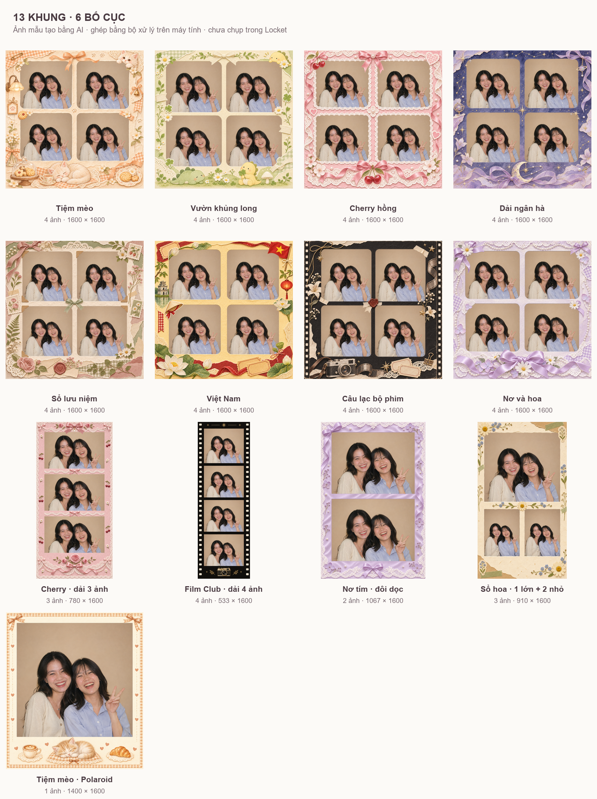

# Locket Custom & Photobooth thử nghiệm

## Link cài trong Shadowrocket

**Module chính — caption và cấu hình camera:**

```text
https://raw.githubusercontent.com/NienCongChua/lk-diamond/main/Locket-Custom.sgmodule
```

**Module dò filter — dùng thêm khi kiểm tra hiệu ứng:**

```text
https://raw.githubusercontent.com/NienCongChua/lk-diamond/main/Locket-Filter-Probe.sgmodule
```

Thêm module từ URL trong Shadowrocket. Bản trực tuyến tự tham chiếu JS trên GitHub, không cần ánh xạ script cục bộ. Tắt module Locket cũ có rule trùng trước khi bật bản Custom mới. Probe có thể bật cùng Custom. HTTPS rewrite cần MITM và CA đã được thiết bị tin cậy; module không tự cài chứng chỉ.

Các URL `script-path` trong module được ghim vào commit đã kiểm tra. Khi cập nhật code, cần tạo lại module để chuyển sang commit mới; xem `tools/make_module.py`.

**Photobooth hiện chưa được nối vào giao diện Locket.** Module chính không thêm nút chụp Photobooth. Bộ ghép và HTTP API đã kiểm thử trên máy tính bằng ảnh giả lập; còn thiếu dữ liệu API filter thực tế để viết adapter. Probe chỉ ghi cấu trúc trường/mã HTTP, không ghi token hay ảnh. Tắt Probe sau khi thử.

## Gói tải về

- [Gói nhỏ cho iPhone](https://raw.githubusercontent.com/NienCongChua/lk-diamond/main/Locket-iPhone-Probe.zip)
- [Toàn bộ mã nguồn và gói thử](https://raw.githubusercontent.com/NienCongChua/lk-diamond/main/Locket-Filter-Trial.zip)
- [13 khung PNG tạo bằng imagegen](https://raw.githubusercontent.com/NienCongChua/lk-diamond/main/Photobooth-AI-Frames.zip)

## Khung có ảnh mẫu và nhiều bố cục

Đã có 13 artwork AI: 8 khung 2×2, dải 3 ảnh Cherry, dải 4 ảnh Film Club, đôi dọc nơ tím, một ảnh lớn + hai ảnh nhỏ và Polaroid tiệm mèo. Mỗi khung có vùng đặt ảnh đo từ PNG thật; chọn khung sẽ chọn đúng số lần chụp. Các bố cục này dùng artwork AI, không còn tự chuyển sang khung vẽ bằng code.

Ảnh dưới là **ảnh mẫu AI ghép bằng bộ xử lý trên máy tính**, không phải ảnh chụp trong Locket. File trong `experimental/frames-ai/` vẫn có ô trong suốt để đặt ảnh của người dùng; file xem trước trong `experimental/demo/` đã có ảnh. `native` giữ tỉ lệ khung, cạnh dài 1600 px; `square` thêm nền để vừa 1600×1600, không kéo méo hoặc cắt dải ảnh.



Tình trạng và phần còn thiếu để nối Locket: [NATIVE_STATUS_VI.md](experimental/NATIVE_STATUS_VI.md).

## Thử phần ghép trên máy tính

```bash
python -m pip install -r experimental/requirements.txt
python experimental/photobooth_http_demo.py
```

Lệnh tự mở dịch vụ localhost, gửi 4 ảnh giả lập, thử gửi lại request và đổi khung, rồi dừng dịch vụ. Kết quả ở `experimental/http-demo/`. Đây không phải lần thử trên iPhone.

Tạo lại toàn bộ ảnh minh họa bằng `python experimental/native_photobooth.py --demo experimental/demo`. Gói ZIP giữ ảnh xem trước từng khung và bảng mẫu; ảnh trung gian của từng lần chụp và ảnh HTTP demo được tạo lại bằng hai lệnh trên để giảm dung lượng tải.

Hướng dẫn đầy đủ: [START_HERE_VI.txt](START_HERE_VI.txt), [README_VI.md](README_VI.md), [cách thử filter](experimental/TRY_NATIVE_VI.txt).

Kiểm thử: [VALIDATION.txt](VALIDATION.txt). Script kế thừa nguồn của nguyencongan và DINH DUY VINH 09; ghi nhận nguồn và giới hạn trong README_VI.md. Mô phỏng phản hồi Gold không tạo giao dịch App Store hoặc nâng quyền trên máy chủ.
